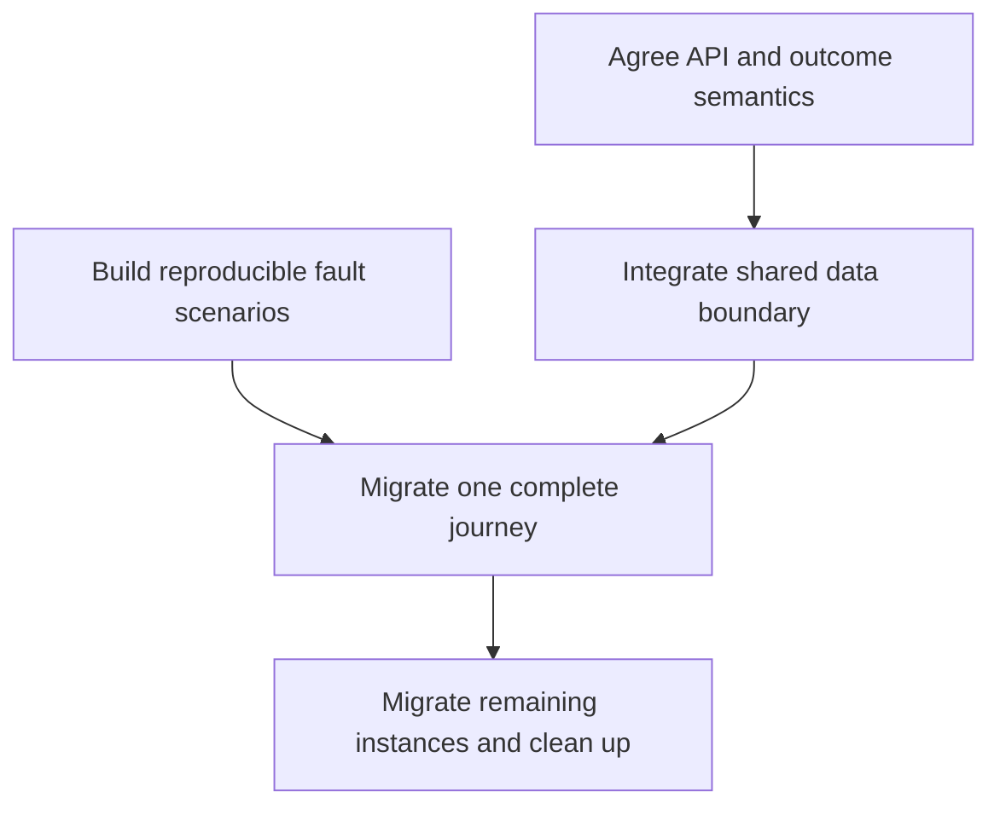

# Component refactor planning

Turn evidence into executable, verifiable, recoverable work. Default to `audit_plan`; when fixes are requested, `implement` includes authorized changes, regression, ledger updates, and delivery. Apply session authority and tool rules to external effects/deployment.

Use the [ledger contract](ledger-contract.md) and stable PAGE/DEF/CMP/BP/SCN/CHK/EV/FND/TASK relationships. Do not create a competing schema.

## 1. Fix scope and target

Identify product stage, inputs, editable boundaries, environment, and behavior to preserve. Continue independent work while listing unknowns. Separate defects, deliberate prototype omissions, and new requirements. Keep existing framework/components/data/design unless a specific demonstrated limit requires replacement.

Replacement proposals need missing capability, compatibility, migration cost, and exit path. Inaccessible roles/source/services/devices remain limits. Convert high-impact unknowns into investigation tasks before proposing broad rewrites. Distinguish a deliverable frontend patch from an end-to-end guarantee requiring server contracts.

## 2. Decide for every instance

Every in-scope CMP has exactly one plan referencing a definition blueprint, with instance-specific changes, acceptance, and regression. No-defect instances still need evidence and a retained contract.

| Decision | Use when | Explain |
|---|---|---|
| `retain` | Current contract meets the target | Instance evidence, preserved behavior, regression |
| `configure` | Existing capability suffices; caller/variant/token is wrong | Exact configuration/caller and default/exception checks |
| `refactor` | Internal ownership/effects/structure cause defects | Compatible external contract and consumer migration |
| `replace` | Proven capability/maintenance limit | Behavior mapping, differences, dependency cost, sequence |
| `remove` | Confirmed unused/duplicate or explicitly cancelled | Consumers/roles/flags checked, alternate path, recovery |
| `investigate` | Source/runtime/contract insufficient | Missing evidence, task/scenario, decision after evidence |

All except retain require tasks. Moving/merging/splitting are concrete actions within these decisions; preserve source/target mappings. Prefer one internally consistent target per component instead of conflicting rewrites per finding.

Replace generic advice with mechanisms: actual state owner/transitions/invalidation; precisely shared versus distinct behavior; named tokens/variants/scope conflicts; semantic/keyboard/focus/announcement actions; specific regression outcomes.

## 3. Design the target contract

Separate current evidence from proposed target. Supply real locations or explicit pending location steps. All ten target dimensions are required; static leaves may be concise and explain non-applicability. Do not invent signatures.

State responsibility/boundaries, inputs/outputs/nullability/defaults, intent-versus-completion events, controlled/local/server/URL ownership, preserve/reset behavior, cache/request/retry/cleanup, tokens/layout, names/keyboard/focus/errors, performance/resources, trust/privacy, diagnostic redaction, integration, caller migration, acceptance/recovery.

Compare behavioral contracts before appearance. Similar cards may share presentation while retaining different business control. Explain controlled/uncontrolled and busy/read-only/disabled semantics; avoid invalid boolean combinations. Test applicable themes/states after token changes. A wrapper alone is not decoupling.

Example proposal, not project evidence: a cancel button expresses “request cancellation for this run”; business code owns job identity and confirmation. List/detail instances share intent semantics but configure layout/focus. Test rejection, lost response, and complete/cancel races before migrating. Missing server confirmation stays a dependency and the UI displays pending honestly.

## 4. Map causes and affected instances

One shared cause can affect many instances without becoming many independent root causes. Trace FND → definition/data/style/protocol → every affected CMP/PAGE/SCN → actual EV → repair TASK → instance acceptance. Distinguish demonstrated shared propagation from runtime verification at each caller.

Record shared evidence, local props/container/role/focus/data differences, automatic versus manual migration, old-consumer/CSS/event risks, verified subset and gaps. Keep frontend/backend tasks linked and prove each side separately. Accepted risk/dismissal needs an authorized decision, not reviewer preference.

## 5. Prioritize by consequence and dependency

Prioritize unauthorized access, wrong-object actions, data loss, repeated costly effects, blocked core tasks, and inaccessible critical journeys by reachability, spread, recoverability, and exposure. High-impact unknowns become early validation tasks. Do not automatically put all accessibility/style work last or treat every security keyword as critical.

Give tasks prerequisites, parallel possibilities, blockers, and an acyclic phase order. Break circular frontend/backend waits with a negotiated contract or isolated verification. Parallel work, if authorized, must not invent competing protocols before the contract stabilizes.

This illustrates dependencies, not preassigned project tasks.

## 6. Migrate in complete slices

| Stage | Deliver | Exit condition |
|---|---|---|
| Baseline | Existing behavior, scope, failures, decisions | Can distinguish failure from repair |
| Critical blockers | Small repair, trusted contract, honest interim UI | Severe failure blocked or explicitly isolated |
| First journey | One page/task plus shared prerequisites | Success/failure/recovery combinations meet contract |
| Remaining callers | Explicit consumer list and differences | Every caller migrated or deliberately retained |
| Cleanup | Unused paths removed, contracts/docs, regression | No dangling callers or unexplained duplicate writes |

Use adapters/flags/dual reads only when the migration needs them; state removal conditions. Do not make duplicated rules permanent. Justify dual writes and their consistency risk. Keep intermediate changes runnable; explain genuinely indivisible boundaries.

Separate reversible UI changes from irreversible data effects. Code rollback cannot recover deleted data or unsend messages; name the real recovery mechanism.

## 7. Backend and external dependencies

Create owned tasks for trusted authorization, idempotency, versions/conflicts, cancellation, durable job queries, persistence, stream identity, file validation, export scope, and quota where needed.

Each states observed issue/evidence/blocked instances; required guarantee and proposed versus existing contract; owner role (pending if unknown); independently deliverable frontend work and its limits; provider/caller completion and end-to-end acceptance; safe degradation and user impact if delayed.

Hiding, timers, memory flags, and client abort do not supply server guarantees. Finish authorized independent fixes rather than stopping all work for one dependency.

## 8. Task and acceptance contract

Tasks should describe one recoverable complete result, not only “engineer the frontend.” Use PRJ/PAGE/DEF/CMP in scope IDs, FND in finding IDs, TASK in dependencies, SCN in verification IDs, and actual EV in evidence IDs.

Each task needs user outcome, linked units, real locations or locating steps, executable changes, contracts/environment/permissions, preserved invariants, normal/fault/recovery acceptance, affected callers/routes/environments, recovery compatibility and data limits, and actual completion evidence.

Write observable criteria: “Return B then A; input/list/detail still show B,” or “show cancellation pending until server terminal confirmation.” Reuse existing tests and replayable scenarios; add tests for concrete regression risks, not every style attribute.

## 9. Implement and recheck

For audit-plan work, deliver evidence and design. For authorized implementation:

1. Read modules/worktree and preserve user changes.
2. Fix the shared cause or owning boundary, then migrate one complete journey; avoid unrelated framework/theme/protocol changes.
3. Execute agreed scenarios in a suitable isolated environment and save evidence of success, failure, recovery.
4. Recheck materially different callers and high-impact instances; explain equivalence sampling and gaps.
5. Link new findings to supported causes, update dependencies, avoid unbounded expansion.
6. Migrate remaining instances, search old callers/rules/styles/effects, remove only proven-unused paths.
7. Reconcile actual changes with plans and distinguish completed, blocked, and unverified.

Use task states planned/in_progress/implemented/verified/blocked/deferred and finding fixed_unverified/resolved correctly. Keep historical evidence. Broaden tests only for remaining risk or required gates; once sufficient, finish delivery. Prepare reviewable results before any genuinely new approval decision.

## 10. Estimates and final completeness

Estimate only when requested or supported. Label rough ranges and confidence with assumptions, implementation/verification/external wait/rework separated. File/line/component counts do not directly determine duration; distinguish total effort from critical-path calendar time. Re-estimate after investigating unknown contracts/builds/dependencies.

Before handoff account for every page, exactly one plan per instance, every definition's blueprint, concrete evidence/acceptance/scenarios, tasks for findings, authorized decisions, dependency owners, acyclic migration, temporary removal conditions, recovery, and honest completion level. Shared mapping is not tested-instance coverage. Plans are not implemented results or launch approval.

## Primary references

Match versions: [Thinking in React](https://react.dev/learn/thinking-in-react), [shared state](https://react.dev/learn/sharing-state-between-components), [effects](https://react.dev/learn/you-might-not-need-an-effect), [CSS cascade](https://developer.mozilla.org/en-US/docs/Web/CSS/Guides/Cascade/Introduction), [WAI-ARIA APG](https://www.w3.org/WAI/ARIA/apg/), [OpenAPI](https://spec.openapis.org/oas/latest.html), [HTTP semantics](https://httpwg.org/specs/rfc9110.html).
